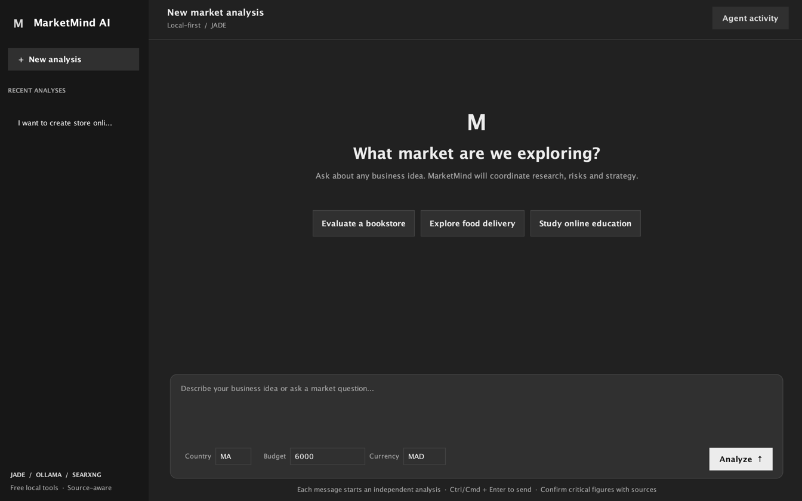
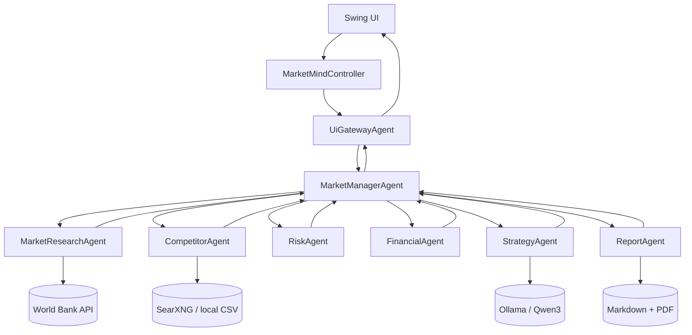

<div align="center">

# MarketMind

**A local-first, multi-agent market intelligence assistant built with Java and JADE.**

Turn a business idea into a structured market research report using autonomous agent coordination, public economic indicators, local web search, and a locally hosted LLM.


</div>

---

## Overview

**MarketMind** is a Java desktop prototype that explores a business idea through a coordinated team of **JADE agents**. Users submit a natural-language request, choose a country, and optionally specify a budget. Specialized agents gather available evidence, examine risks, prepare an illustrative financial allocation, and generate a strategy and report.

The application uses **Ollama** for local language-model inference, **SearXNG** for self-hosted search, and the **World Bank API** for public economic indicators. **No paid AI or search API keys are required.**

> **Project status:** An educational/research prototype, not a production-grade market research platform or financial advisor. Outputs require independent validation.

## Interface



*Chat-inspired Java Swing workspace with a monochrome theme. Each new analysis is a separate research task, not a persistent multi-turn AI conversation.*

## Features

- **Open-ended requests** — analyze different sectors and business ideas without hardcoded industries.
- **Multi-agent coordination** — JADE ACL messages coordinate research, competitor exploration, risk checks, financial planning, strategy, and reporting.
- **Local AI strategy** — Qwen3 through Ollama, with a rule-based fallback when the model is unavailable.
- **Search-assisted research** — SearXNG discovers candidate competitors and relevant web results; matches are **not automatically verified**.
- **Economic context** — World Bank indicators provide country-level data, with sources and limitations.
- **Financial planning** — optional budget allocation as an **illustrative scenario**, not a profitability forecast.
- **Chat-inspired desktop interface** — dark grayscale palette, request composer, agent activity, and session-only analysis history.
- **Exportable reports** — editable Markdown and generated PDF, with warnings about evidence quality.

## Architecture



The manager dispatches four initial analysis tasks, gathers their findings, requests an evidence-aware strategy, and sends the combined results for report generation. JADE handles coordination; external data access and LLM inference happen in dedicated Java services.

### Agent responsibilities

| Agent | Responsibility |
| --- | --- |
| `MarketManagerAgent` | Orchestrates requests, collects findings, and coordinates report creation. |
| `MarketResearchAgent` | Retrieves public macroeconomic indicators. |
| `CompetitorAgent` | Finds potential competitor references from search or local CSV data. |
| `RiskAgent` | Generates a structured checklist of risks to investigate. |
| `FinancialAgent` | Creates illustrative budget allocations. |
| `StrategyAgent` | Synthesizes findings with a local LLM or rule-based fallback. |
| `ReportAgent` | Exports analysis to Markdown and PDF. |
| `UiGatewayAgent` | Transfers requests, results, and status events between Swing and JADE. |

## Technology stack

| Layer | Technology |
| --- | --- |
| Language | Java 17 |
| Build and dependencies | Apache Maven |
| Multi-agent framework | JADE 4.3 |
| Desktop interface | Java Swing |
| Local LLM | Ollama (`qwen3:4b` by default) |
| Search | Self-hosted SearXNG |
| Economic indicators | World Bank API |
| JSON | Jackson |
| PDF generation | Apache PDFBox |
| Testing | JUnit 5 |

## Getting started

### Prerequisites

- **JDK 17** and **Maven** installed.
- **Ollama** installed and running on your computer.
- **Docker Desktop** (or a Docker engine) for SearXNG.
- Internet access for initial downloads, web search, and World Bank queries.

### 1. Clone the repository

```bash
git clone https://github.com/Ben10-L/MarketMind.git
cd MarketMind
```

*If the repository is private, authenticate with a GitHub account that has access.*

### 2. Prepare the local language model

```bash
ollama pull qwen3:4b
ollama list
curl http://localhost:11434/api/tags
```

If Ollama is not already running, start the Ollama desktop service or run `ollama serve` in another terminal.

### 3. Start the search service

With Docker running, execute from the project root:

```bash
bash scripts/start-searxng.sh
curl 'http://localhost:8888/search?q=market+research&format=json'
```

The script creates a private local configuration under `.local/searxng/`, enables JSON results, and publishes SearXNG only on `127.0.0.1:8888`.

### 4. Test and launch

```bash
mvn clean test
mvn exec:java
```

Or import `pom.xml` into IntelliJ IDEA and run `com.marketmind.Main` using JDK 17.

## Example request

> I want to launch a bookstore in Morocco with a budget of 50,000 MAD. Analyze the market, potential competitors, risks, and suggest a realistic pilot plan.

In the interface:

1. Enter your business idea in the request composer.
2. Set the country code (for example, `MA`) and an optional budget and currency (`MAD`).
3. Select **Analyze** to start the JADE workflow.
4. Review the result, sources, warnings, and agent activity.
5. Open the generated PDF report or inspect the Markdown version.

Reports are written to:

```text
reports/
├── marketmind-<request-id>.md
└── marketmind-<request-id>.pdf
```

The interface's recent-analysis list is kept **in memory during the current session**. The generated report files remain on disk; reopening the application does not restore the in-memory conversation list.

## Configuration

Default settings are in `src/main/resources/config.properties`. For non-sensitive overrides, use environment variables:

| Variable | Default | Purpose |
| --- | --- | --- |
| `OLLAMA_URL` | `http://localhost:11434` | Local Ollama endpoint |
| `OLLAMA_MODEL` | `qwen3:4b` | Installed Ollama model |
| `SEARXNG_URL` | `http://localhost:8888` | Local SearXNG endpoint |

Additional configuration includes `worldbank.enabled=true` and `search.max-results=5`.

**No `OPENAI_API_KEY` or `BRAVE_SEARCH_API_KEY` is required.** Do not commit local secrets, `.env` files, or `.local/searxng/` settings.

## Project structure

```text
MarketMind/
├── data/
│   ├── raw/                 # Optional local datasets / competitor CSV
│   └── processed/
├── docs/                    # Architecture and integration notes
│   └── assets/              # README screenshots
├── reports/                 # Generated Markdown / PDF (gitignored)
├── scripts/
│   └── start-searxng.sh
├── src/
│   ├── main/
│   │   ├── java/com/marketmind/
│   │   │   ├── agents/       # JADE agents
│   │   │   ├── api/          # Ollama, SearXNG, World Bank clients
│   │   │   ├── behaviours/   # JADE behaviours
│   │   │   ├── config/       # API configuration
│   │   │   ├── controllers/  # Swing / JADE bridge
│   │   │   ├── models/       # Request and result models
│   │   │   ├── services/     # Analysis and report generation
│   │   │   ├── ui/           # Swing interface / theme
│   │   │   ├── utils/
│   │   │   └── Main.java
│   │   └── resources/
│   └── test/java/           # JUnit tests
├── pom.xml
└── README.md
```

## Reliability and limitations

- **Search results are leads, not proof.** Competitor entries may be unrelated, outdated, or incomplete; verify them against primary sources.
- **Macroeconomic data is contextual.** World Bank indicators do not establish demand for a specific product or city.
- **Financial outputs are illustrative.** Budget splits are not validated costs, revenue projections, or investment recommendations.
- **LLM output can be incomplete or inaccurate.** Validate facts, source dates, and strategy assumptions before use.
- **Local-first does not mean offline.** Ollama inference runs locally, while SearXNG queries external search engines and World Bank queries require internet access.
- **Graceful degradation is limited.** If search or the LLM is unavailable, the application can fall back to local CSV or rule-based guidance; analysis quality may drop substantially.
- **PDFs are dark-themed.** The monochrome PDF design is intended for screen reading and can consume more printer ink.


## Project documentation

- [Architecture](docs/architecture.md)
- [Agent communication](docs/agent-communication.md)
- [API integration](docs/api-integration.md)
- [Interface design](docs/ui-design.md)

## Author and usage

Developed and maintained by [Ben10-L](https://github.com/Ben10-L) as a multi-agent systems and AI engineering project.
