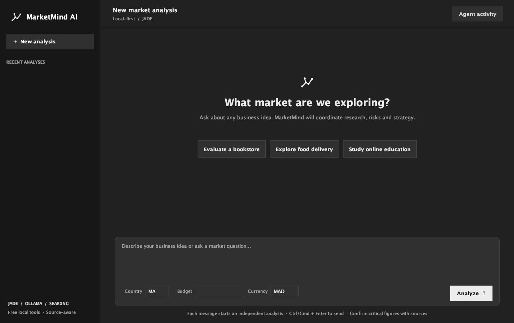
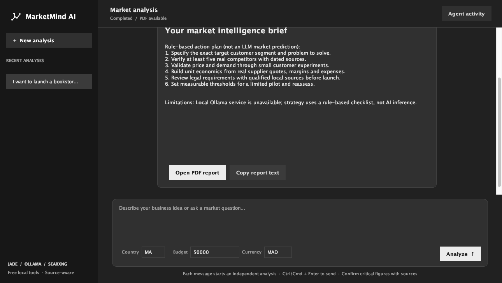
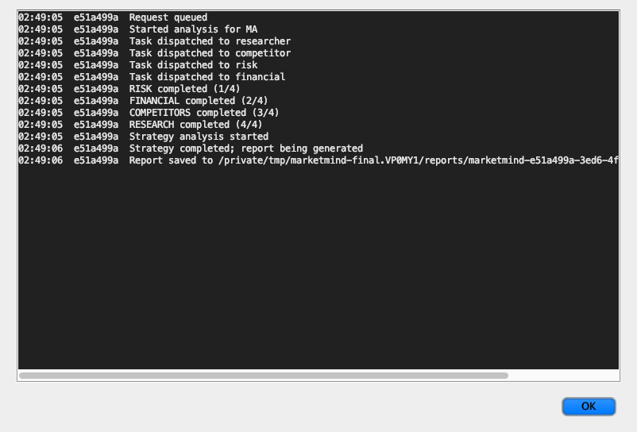
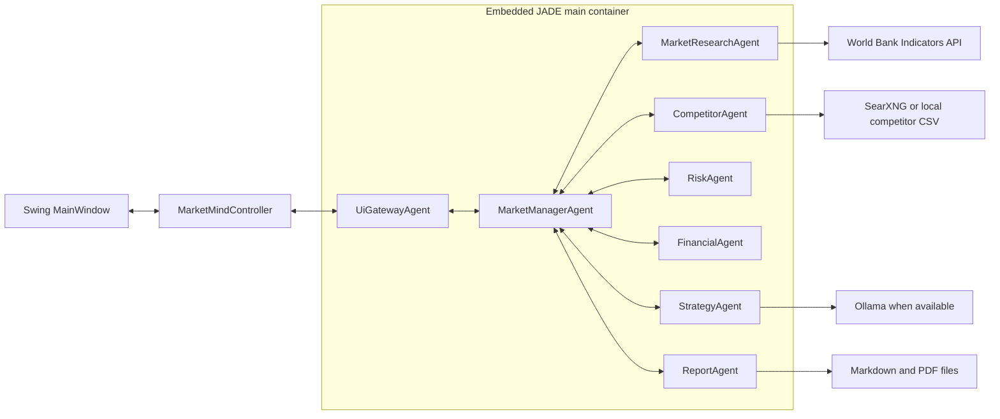
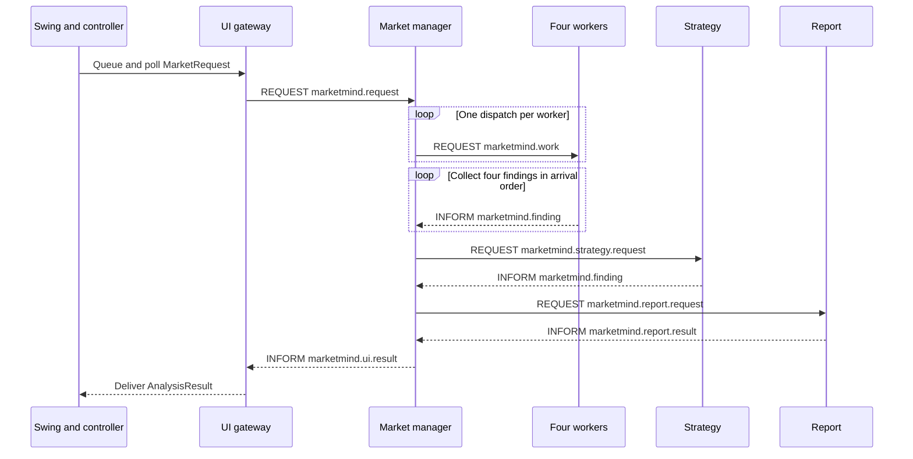

<h1 align="center">
  <picture>
    <source media="(prefers-color-scheme: dark)" srcset="docs/brand/marketmind-white.svg">
    
  </picture>
  <br>
  MarketMind
</h1>
<p align="center"><strong>Intelligent Multi-Agent Market Analysis System</strong></p>
<p align="center">A Java desktop application that coordinates market research, competitor discovery, risk review, budget allocation, and strategy through JADE agents.</p>
<p align="center">
  
  
  
</p>

## Overview

Early market research brings together data with different levels of confidence. MarketMind gives each analysis task to a specialized agent and assembles the results into a single brief. The report keeps macroeconomic data, candidate competitors, illustrative budget allocations, and strategy guidance distinguishable through source links and limitations.

## Key Features

- Submit a business question with a country code, optional budget, and currency in a monochrome Swing workspace.
- Follow agent dispatch and completion in the activity dialog. Reopen earlier requests from the current session.
- Collect country-level population, inflation, and GDP data. Find competitor leads through SearXNG or a local CSV.
- Compile a risk checklist and illustrative budget allocation. Produce strategy guidance using Ollama when available, with a rule-based fallback.
- Preview the strategy in Swing, copy the report text, and access the generated PDF and Markdown files in `reports/`.

## Application Preview

The screens below were captured from the running Swing application. The two workflow views show a bookstore analysis for Morocco with a 50,000 MAD budget and the rule-based strategy fallback.







## Multi-Agent Architecture



| Agent | Local name | Behaviour and responsibility |
| --- | --- | --- |
| `UiGatewayAgent` | `ui` | A 150 ms `TickerBehaviour` drains the controller queue. A `CyclicBehaviour` relays status and results to controller listeners. |
| `MarketManagerAgent` | `manager` | A `CyclicBehaviour` dispatches four worker jobs, aggregates findings by request and role, and calls strategy and report in order. A five-second ticker expires jobs older than 150 seconds. |
| `MarketResearchAgent` | `researcher` | `MarketAnalysisBehaviour` fetches the latest available country indicators and records source links or availability warnings. |
| `CompetitorAgent` | `competitor` | `CompetitorAnalysisBehaviour` queries SearXNG and tries matching local competitor rows when no search candidates are returned. |
| `RiskAgent` | `risk` | `RiskAssessmentBehaviour` returns a checklist covering demand, competition, operations, compliance, and data gaps. |
| `FinancialAgent` | `financial` | `MarketAnalysisBehaviour` applies preset allocation ratios to a supplied budget and labels the results as illustrative. |
| `StrategyAgent` | `strategy` | A `CyclicBehaviour` combines worker findings and warnings into input for Ollama. A fixed action plan covers unavailable or failed inference. |
| `ReportAgent` | `report` | `ReportGenerationBehaviour` saves Markdown and PDF reports and returns the result to the manager. |

`Main` creates the main container, starts the eight application agents, and schedules the Swing window on the Event Dispatch Thread. Each agent registers its behaviours in `setup()`. Cyclic consumers block when their mailbox has no matching work. Swing renders controller updates on the Event Dispatch Thread. Closing the main window exits the desktop process.

## Agent Communication

The following successful request uses the same message path whether strategy comes from Ollama or the fallback. Worker findings can arrive in any order.



Agents address one another by JADE local name. The request UUID becomes the ACL conversation ID, and the `marketmind.*` ontology tags identify message purposes. Request, finding, bundle, and result objects travel as serialized Java payloads. The manager also emits `INFORM marketmind.ui.status` text messages throughout the workflow. Worker failures emit `FAILURE` and leave the request waiting for the remaining finding until timeout. A strategy agent failure can proceed to reporting with a fallback note. A report failure closes the request and publishes an error status.

## Technology Stack

| Technology | Role |
| --- | --- |
| Java 17 and Maven | Application runtime target and build |
| JADE 4.3 Maven artifact | Agent lifecycle, behaviours, and ACL messaging |
| Java Swing | Desktop workspace |
| Java HTTP Client and Jackson | HTTP requests and JSON parsing |
| Apache PDFBox | PDF report generation |
| JUnit 5 and Maven Surefire | Automated service and model tests |

## Data Sources and APIs

| Source | Role | Configuration and limits |
| --- | --- | --- |
| [World Bank Indicators API](https://datahelpdesk.worldbank.org/knowledgebase/articles/889392-about-the-indicators-api-documentation) | Population, annual consumer price inflation, and GDP in current US dollars | Enabled by `worldbank.enabled=true` in [config.properties](src/main/resources/config.properties). Requires internet access. Indicators have country-level granularity and can have different observation years. |
| [SearXNG](https://docs.searxng.org/) | Search result titles, descriptions, and URLs used as competitor leads | Set `SEARXNG_URL` as needed. Defaults to `http://localhost:8888`. The instance must enable JSON output. `search.max-results` defaults to five and is capped at ten. Leads require independent verification. |
| [Local competitor CSV](data/raw/competitors.csv) | Manually curated fallback for competitor discovery | Use `country,sector,name,description,url` in the repo-root CSV. Matching requires the country and a sector substring in the request. The parser skips quoted rows. |
| [Ollama](https://ollama.com/) | Optional strategy generation from the request and collected findings | `OLLAMA_URL` defaults to `http://localhost:11434`. `OLLAMA_MODEL` defaults to `qwen3:4b`. The strategy agent uses a rule-based fallback when generation is unavailable or fails. |

The application reads URL and model overrides from the process environment. The bundled market data CSV is present as a sample. The current research service reads its indicators from the World Bank API. The default integration paths are key-free.

## Installation and Execution

Install JDK 17 or later and Maven on a machine with a graphical desktop. Run the following from the repository root so relative data and report paths resolve correctly.

```sh
git clone https://github.com/Ben10-L/MarketMind.git
cd MarketMind
java -version
mvn -version
mvn clean verify
mvn exec:java
```

Maven downloads JADE and the other Java dependencies. `mvn exec:java` launches `com.marketmind.Main`, which starts JADE and opens Swing in the same process. The default startup uses JADE's JICP port 1099 and HTTP MTP port 7778. Keep those ports available. The application disables JADE's own management GUI.

For optional live integrations, start Ollama and install the configured model, then start SearXNG with a running Docker engine and OpenSSL. Run `ollama serve` in a separate terminal if Ollama is not already running.

```sh
ollama pull qwen3:4b
bash scripts/start-searxng.sh
mvn exec:java
```

For a fallback smoke run, direct both optional services to an unused local port. Choose **Evaluate a bookstore**, enter a budget, and select **Analyze**. Open **Agent activity** to inspect the dispatch and completion events.

```sh
OLLAMA_URL=http://127.0.0.1:1 SEARXNG_URL=http://127.0.0.1:1 mvn exec:java
```

## Project Structure

```text
MarketMind/
├── data/raw/               CSV inputs and samples
├── docs/
│   ├── brand/              Black and white SVG and PNG marks
│   └── screenshots/        Captures from the running Swing app
├── reports/                Generated Markdown and PDF briefs
├── scripts/                SearXNG startup helper
├── src/
│   ├── main/
│   │   ├── java/com/marketmind/
│   │   │   ├── agents/     JADE agents
│   │   │   ├── behaviours/ Message-handling behaviours
│   │   │   ├── api/        External integrations
│   │   │   ├── services/   Analysis and report output
│   │   │   └── ui/         Swing interface
│   │   └── resources/      API configuration and Swing icons
│   └── test/java/          JUnit tests
└── pom.xml
```

## Testing and Validation

The OpenJDK 17 build passed all six JUnit tests. A desktop smoke run reached report completion via all four workers, the rule-based strategy, and both exports. See [TESTING.md](TESTING.md) for the verified workflow and remaining desktop checks.

## Limitations and Future Improvements

- Country indicators describe economic context. Independent local research is needed to estimate demand for a specific business.
- Competitor discovery returns leads. A future evidence review could rank candidates by relevance and record verification dates.
- Risk guidance is checklist-based and financial allocations use preset ratios. Real cost inputs and validated demand assumptions would support a richer model.
- History lasts for the desktop session. A future history store could link saved reports to prior requests.
- Provider timeouts and failures can reduce the available evidence. Agent-level integration tests would improve regression coverage for partial results and failures.

## License and Author

Developed and maintained by [Ben10-L](https://github.com/Ben10-L) as a multi-agent systems and AI engineering project. The repository currently has no project license file.
